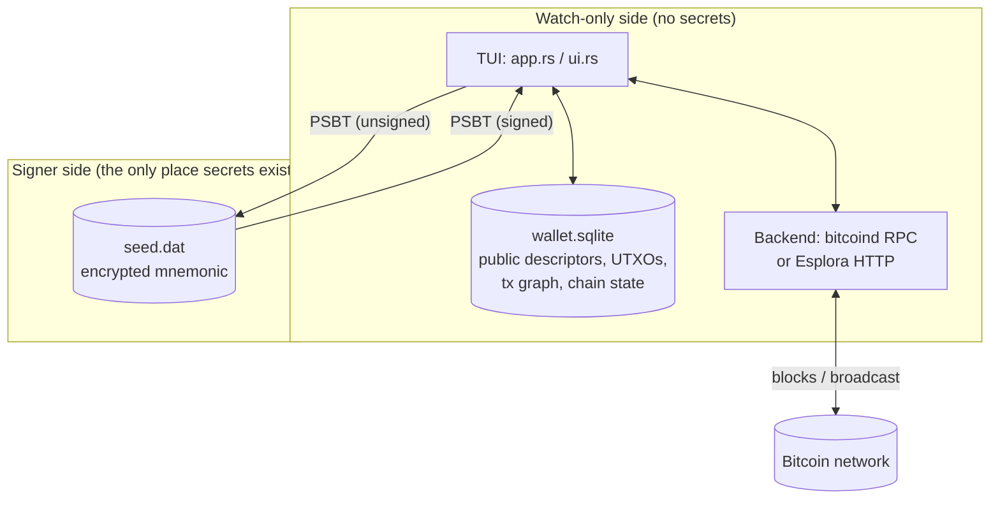

# rfb_wallet — Presentation Guide

A complete reference for presenting this capstone: what it is, how every MVP requirement maps to
actual code, how `bdk_wallet` (and the rest of the BDK family) does the heavy lifting, the Bitcoin
concepts you'll want to explain in plain language, and a step-by-step demo script covering every
screen in the app — including the multisig feature built on top of the MVP.

---

## 1. The one-paragraph pitch

`rfb_wallet` is a **non-custodial Bitcoin wallet** with a terminal UI (TUI). "Non-custodial" means
the thing that can _see_ your balance (the watch-only wallet database) and the thing that can
_spend_ your money (your seed phrase) are deliberately kept apart, connected only by a signed
piece of paper — a PSBT. It supports single-sig (SegWit and Taproot) and real configurable N-of-M
multisig wallets, talks to the Bitcoin network either through your own `bitcoind` node or a remote
Esplora server, and is built almost entirely on top of `bdk_wallet`, the Rust ecosystem's
reference wallet-development library.

---

## 2. Architecture at a glance



Two files per wallet, two different trust levels:

| File            | Contains                                                                     | Who needs it                                                                                                 |
| --------------- | ---------------------------------------------------------------------------- | ------------------------------------------------------------------------------------------------------------ |
| `wallet.sqlite` | Public descriptors, known UTXOs, transaction graph, chain checkpoints        | The watch-only side — can show balance/history, build _unsigned_ transactions, broadcast already-signed ones |
| `seed.dat`      | The BIP39 mnemonic, encrypted with a password (Argon2id + ChaCha20-Poly1305) | Only whoever is allowed to actually spend                                                                    |

The two sides only ever communicate through a **PSBT** (Partially Signed Bitcoin Transaction,
BIP174) — the same mechanism a hardware wallet uses. This is the real-world architecture of "cold
storage": an always-online watch-only node, and an offline signer that only ever sees a PSBT, never
the network. `bdk_wallet` enforces this for us — it **never persists private key material to
disk**, even if you construct a wallet directly from an `xprv`-bearing descriptor (proven in code:
`src/walletdb.rs::create` passes a `Bip84<Mnemonic>` template, which _does_ carry the private
mnemonic, straight into `Wallet::create(...).create_wallet(&mut conn)`, and what lands in
`wallet.sqlite` afterward is public-only).

---

## 3. MVP requirements → code

The original capstone spec asked for a non-custodial wallet that can do the following. Here's
exactly where each requirement lives:

| Requirement                                             | Where                                                                                             | Key bdk/bitcoin API                                                                            |
| ------------------------------------------------------- | ------------------------------------------------------------------------------------------------- | ---------------------------------------------------------------------------------------------- |
| Create wallet from a new mnemonic                       | `seed.rs::Seed::generate`                                                                         | `bdk_wallet::keys::bip39::Mnemonic::generate`                                                  |
| Restore wallet from an existing mnemonic                | `seed.rs::Seed::parse`                                                                            | `Mnemonic::parse_in`                                                                           |
| BIP32/BIP84 hierarchical derivation (`m/84'/1'/0'/0/*`) | `seed.rs::bip84_templates`, `walletdb.rs::create`                                                 | `bdk_wallet::template::Bip84`                                                                  |
| Generate/track receive addresses                        | `app.rs::do_address`                                                                              | `Wallet::reveal_next_address(KeychainKind::External)`                                          |
| Sync with the chain                                     | `sync.rs::sync`                                                                                   | `bdk_bitcoind_rpc::Emitter` **or** `bdk_esplora::EsploraExt::full_scan`                        |
| Confirmed/unconfirmed balance                           | `ui.rs::render_balance_panel`                                                                     | `Wallet::balance()` → `Balance { confirmed, trusted_pending, untrusted_pending, immature }`    |
| Transaction history                                     | `history.rs::history`                                                                             | `Wallet::transactions()`, `Wallet::sent_and_received()`                                        |
| Sign via PSBT                                           | `send.rs::sign_psbt`                                                                              | `bdk_wallet::signer::SignersContainer` + `Wallet::sign_with_signers`                           |
| Broadcast                                               | `send.rs::broadcast_psbt`, `backend.rs::Backend::broadcast`                                       | `bitcoincore_rpc::Client::send_raw_transaction` or `esplora_client::BlockingClient::broadcast` |
| Poll transaction status                                 | `history.rs` (`TxStatus::Confirmed { confirmations }` computed from `tip_height - anchor.height`) | `bdk_wallet::chain::ChainPosition`                                                             |
| Persist wallet state                                    | `walletdb.rs`                                                                                     | `bdk_wallet::rusqlite::Connection` (implements `WalletPersister`)                              |

Every single one of these is a thin layer of _our_ code (CLI parsing, TUI forms, file I/O) wrapped
around `bdk_wallet` doing the actual Bitcoin logic. That's the core talking point: **we are not
reimplementing wallet internals — we're composing a well-tested library correctly.**

---

## 4. How BDK lines up with this wallet, crate by crate

BDK ("Bitcoin Dev Kit") isn't one crate — it's a family. This project uses four of them, each for
a distinct job:

### `bdk_wallet` (the core)

Everything about _what the wallet knows_: descriptors, keychains, the UTXO/transaction graph,
balance calculation, coin selection, and transaction building.

- **`Wallet` / `PersistedWallet<P>`** — `walletdb.rs` defines `pub type OpenWallet =
PersistedWallet<Connection>`. `PersistedWallet` wraps `Wallet` and implements `Deref<Target =
Wallet>`, so everywhere in the code that calls `wallet.balance()` or `wallet.transactions()` is
  really calling straight through to `bdk_wallet::Wallet`.
- **`Wallet::create(external, internal)` / `Wallet::load()`** — the two ways a wallet comes into
  existence. `create` takes anything implementing `IntoWalletDescriptor` (a BIP84/86 template, or
  a raw descriptor `String` for multisig) for each of the two keychains.
- **`KeychainKind::External` / `Internal`** — the receive-address chain and the change-address
  chain. Every API that needs "which set of addresses" takes this enum.
- **`bdk_wallet::template::{Bip84, Bip86}`** — pre-built descriptor templates that do the BIP32
  derivation math for you. `Bip84(key, KeychainKind::External)` becomes `m/84'/{0,1}'/0'/0/*`
  depending on network; `Bip86` does the Taproot equivalent at `m/86'/...`. There's no `Bip48`
  template (multisig isn't single-key), so that path is hand-built — see §6.
- **`TxBuilder` / `Wallet::build_tx()`** — `send.rs::build_unsigned` is almost entirely this:
  `wallet.build_tx().add_recipient(...).fee_rate(...).finish()`. Coin selection (branch-and-bound),
  change output creation, and fee calculation all happen inside `bdk_wallet` here.
- **`Wallet::build_fee_bump(txid)`** — RBF (BIP125) replacement, used by `send.rs::bump_fee`.
  `bdk_wallet` handles picking which inputs/outputs carry over automatically.
- **`SignersContainer::build(keymap, descriptor, secp)` / `Wallet::sign_with_signers`** — the
  signing engine. Give it a `KeyMap` (private keys) and the wallet's own descriptor (which
  pubkeys are expected where), and it fills in signatures for whichever PSBT inputs it can,
  generically — this works identically whether the descriptor is single-sig `wpkh(...)` or
  multisig `wsh(sortedmulti(...))`, with **zero special-casing in our code**.
- **`WalletPersister` trait, implemented by `rusqlite::Connection`** — this is _why_ SQLite was
  the obvious persistence choice: `bdk_wallet` ships a ready-made SQLite schema and
  create/load/persist implementation. `Wallet::create(...).create_wallet(&mut conn)` and
  `Wallet::load().load_wallet(&mut conn)` are both `bdk_wallet` functions, not ours.
- **`ChainPosition<ConfirmationBlockTime>`** — the `Confirmed { anchor, .. } | Unconfirmed { .. }`
  enum every transaction carries, used throughout `history.rs` to compute confirmation counts.

### `bdk_bitcoind_rpc` (chain source #1: your own node)

- **`Emitter::new(rpc, wallet_tip, start_height, unconfirmed_txids)`** — walks `bitcoind` block by
  block from the wallet's last-known tip to the current chain tip, handling reorgs correctly by
  emitting "connect" and "disconnect" events. `sync.rs::sync_bitcoind` calls `emitter.next_block()`
  in a loop, applying each one with `wallet.apply_block_connected_to(...)`.
- **`emitter.mempool()`** — after catching up on blocks, pulls current mempool contents so
  unconfirmed transactions show up immediately, not just after confirmation.

### `bdk_esplora` (chain source #2: a remote block explorer, no node required)

- **`EsploraExt::full_scan(request, stop_gap, parallel_requests)`** — a trait bolted onto
  `esplora_client::BlockingClient`. Instead of replaying blocks, it asks the Esplora HTTP API
  "does this address have any history?" for each derived address, stopping after `stop_gap`
  (5, kept deliberately lower than `bdk_wallet`'s own default lookahead of 25 — scanning both
  keychains at 25 means up to 50 HTTP requests just to create one empty wallet, enough to trip
  rate limits on public servers like Blockstream's unauthenticated API) consecutive unused
  addresses.
- **`FullScanRequestBuilder::inspect(closure)`** — fires once per scanned address, which is what
  `sync.rs::sync_esplora` hooks to drive the live "Scanning External index N" progress message
  (see §8, "sync progress").
- This is the **fundamentally different sync paradigm** worth highlighting in a presentation:
  `bdk_bitcoind_rpc` is push-based (the node tells you about blocks), `bdk_esplora` is pull-based
  (you ask about specific addresses). `backend.rs::Backend` is an enum unifying both behind one
  `sync()` call so the rest of the app never needs to care which one is active.

### `bitcoin` (rust-bitcoin, the foundation everything else sits on)

- **`Psbt`** — BIP174 implementation. The `base64` Cargo feature is enabled specifically so `Psbt`
  gets `Display`/`FromStr` for free (`psbt.to_string()` / `text.parse::<Psbt>()`), which is all
  `send.rs`'s export/import PSBT flow needs — no separate base64 dependency required.
  **Fun fact for the audience:** every valid PSBT's base64 text starts with `cHNi` because that's
  the base64 encoding of the magic bytes `0x70 0x73 0x62 0x74` ("psbt").
- **`bip32::{Xpriv, Xpub, DerivationPath, Fingerprint, ChildNumber}`** — the raw hierarchical-key
  machinery used directly (not through a template) for the multisig BIP48 path — see §6.
- **`Network`, `Address`, `Amount`, `FeeRate`** — used everywhere for type safety: you cannot
  accidentally pass a mainnet address to a regtest wallet, the compiler won't let you add
  satoshis to a `FeeRate`, etc.

### `bitcoincore-rpc`

Raw JSON-RPC calls that aren't wallet-level concerns at all: `send_raw_transaction` (broadcast),
`estimate_smart_fee` (fee estimation), and `generate_to_address` (regtest-only mining, used by the
`[m]` dashboard key). Deliberately kept separate from `bdk_bitcoind_rpc`, which only handles
_syncing_.

---

## 5. Bitcoin concepts to explain in plain language

Have these ready for Q&A — a reviewer who knows Bitcoin will probe these.

**BIP39 → BIP32 → BIP84/86/48 (the derivation chain).** A 12-word mnemonic (BIP39) deterministically
produces a 64-byte seed, which becomes a single master key (BIP32). From that one master key you
can derive a practically infinite tree of child keys by walking a _path_ like `m/84'/0'/0'/0/5`.
Apostrophes mean "hardened" derivation — it mixes in the _parent's private key_, not just its
public key, as part of the math, which is why a leaked child **private** key alone can't be used
to work backward and steal the whole account (hardened steps block that attack; non-hardened
steps don't). BIP84/86/48 are just _conventions_ for which numbers to put in that path so
different wallet software agrees on where to look: `84'` = SegWit single-sig, `86'` = Taproot
single-sig, `48'` = multisig.

**Output descriptors.** A compact string that says exactly what kind of script locks a coin and
how to derive the keys that can spend it — e.g. `wpkh([fingerprint/84'/0'/0']xpub.../0/*)` for a
single-sig SegWit receive chain, or `wsh(sortedmulti(2,key1/0/*,key2/0/*,key3/0/*))` for 2-of-3
multisig. This is the modern standard way wallets describe themselves to each other, and it's
_literally_ what gets stored in `wallet.sqlite` — `wallet.public_descriptor(KeychainKind::External)`
returns exactly this string.

**UTXOs, not accounts.** Bitcoin has no balances — only unspent transaction outputs (UTXOs), each
a discrete "coin" of some value. Spending means consuming whole UTXOs as inputs and creating new
ones as outputs (to the recipient, and "change" back to yourself). `Wallet::list_unspent()`
(backing the `[u]` coin-picker screen) is this wallet's view of every UTXO it currently owns.

**PSBT (BIP174).** A standard binary format for a transaction that isn't fully signed yet, carrying
everything a signer needs (the UTXOs being spent, the scripts, derivation paths) without needing
network access. This is what makes air-gapped signing possible: the watch-only side builds a PSBT
and hands it over (file, QR code, USB drive — doesn't matter), the signer adds a signature to that
_same object_ without ever touching the internet, and hands it back. `send.rs::sign_psbt` is
proof this requires zero network access — it takes no `Backend` parameter at all.

**RBF (BIP125, Replace-By-Fee).** A transaction can opt in to being replaceable before it confirms
— useful when you set too low a fee and it's stuck in the mempool. `Wallet::build_fee_bump`
constructs a replacement automatically, reusing the original inputs/outputs where possible.

**Coinbase maturity.** A block's mining reward can't be spent until 100 further blocks have been
mined on top of it (consensus rule, prevents spending rewards from a block that later gets
reorged out). `bdk_chain`'s exact rule is `age + 1 < 100` is immature — i.e. a coinbase matures
once `tip_height >= coinbase_height + 99`. Get this wrong in a demo and a "send" will fail with
`bad-txns-premature-spend-of-coinbase` from bitcoind — the coin-picker screen (`ui.rs::coin_status_label`)
exists specifically to show "immature coinbase (N/100)" so this is never a surprise.

---

## 6. The multisig feature, explained

This is the headline "beyond MVP" feature, so it's worth a dedicated walkthrough of _why_ it was
built the way it was.

**Why BIP48, not BIP84/86.** Real wallets (Sparrow, Specter, Coldcard) all put multisig keys at
`m/48'/coin'/account'/script_type'`, with `script_type' = 2'` meaning native SegWit P2WSH. This
wallet always uses `m/48'/{0,1}'/0'/2'`. There's no `Bip48` template in `bdk_wallet` (templates are
inherently single-key), so `seed.rs::multisig_account_xprv` derives it by hand using raw
`bitcoin::bip32` calls — the one place in this codebase that talks to BIP32 directly instead of
through a `bdk_wallet` template.

**The descriptor.** `wsh(sortedmulti(M, key1/0/*, key2/0/*, ..., keyN/0/*))` — `sortedmulti` sorts
the actual pubkeys at script-construction time, so it doesn't matter what order the keys are
listed in the string; everyone building the same key _set_ ends up with the same addresses.

**Creating the wallet.** Your own key goes in as an **xprv** (private), everyone else's as a
pasted-in **xpub** fragment (public only — you never see their private keys). This descriptor
string is passed straight to `Wallet::create(...)`, exactly the same call used for single-sig,
and `bdk_wallet` strips the private key out before anything touches disk — same non-custodial
guarantee as the single-sig path, just with more than one key in the descriptor.

**Signing later, after a restart.** This is the elegant part: signing does _not_ reconstruct the
whole multisig descriptor (which would require knowing every cosigner's key again). It only
rebuilds **your own** key as a one-entry `KeyMap`, then hands that to the exact same
`SignersContainer::build` + `Wallet::sign_with_signers` call the single-sig path already used.
`SignersContainer::build` walks whatever descriptor the wallet actually has — single-key or
multisig — looking for a pubkey that matches something in the supplied `KeyMap`. **No new signing
code was needed at all** — only a new way to produce the `KeyMap`.

**Round-robin signing "just works."** `bdk_wallet`'s `SignOptions::default()` already has
`try_finalize: true`. Signing a 2-of-3 PSBT with only 1 of the 2 required signatures present
doesn't error — it signs what it validly can, embeds that partial signature in the PSBT, and
reports `finalized = false`. Hand that same PSBT file to the next signer, they run it through the
same sign step, and once the threshold is met it reports `finalized = true` and is ready to
broadcast. This sequential hand-off model is exactly how hardware-wallet multisig ceremonies work
in the real world.

**Reading "2-of-3" back out of a loaded wallet.** No extra file is needed — `wallet.sqlite`'s own
stored descriptor already encodes the threshold. `seed.rs::multisig_threshold` pattern-matches
`Descriptor::Wsh(wsh)` → `WshInner::SortedMulti(smv)` → `smv.k()` / `smv.n()` to read it straight
back out, the same "ask the descriptor, don't store it twice" philosophy as `script_kind_of`.

---

## 7. Full usage walkthrough (demo script)

### Starting the app

```sh
# Regtest (default) against your own bitcoind:
cargo run -- --network regtest --rpc-cookie ~/bitcoin-regtest/regtest/.cookie

# Signet/mainnet/testnet against your own bitcoind (uses Bitcoin Core's standard cookie path
# automatically if you don't pass --rpc-cookie):
cargo run -- --network signet

# Any network against a remote Esplora server instead of running your own node:
cargo run -- --network signet --esplora-url https://mempool.space/signet/api
```

Other flags: `--data-dir <path>` (defaults to `~/.rfb_wallet`), `--rpc-url`, `--rpc-user`/`--rpc-pass`
(alternative to cookie auth).

### First run / wallet picker

- No wallets yet → straight to the picker screen: `[n]` new, `[r]` restore, `[q]` quit.
- Exactly one wallet exists → auto-loads and syncs it, straight to the Dashboard.
- More than one → picker with `Up`/`Down`/`Enter` to choose.

### Creating a wallet

1. `[n]` → type a name → `Enter`.
2. Script type screen: `Up`/`Down`/`Tab` cycles **SegWit → Taproot → Multisig → SegWit**. `Enter`
   to confirm.
   - SegWit/Taproot: skips straight to the password screen.
   - Multisig: two more screens first — total signers (N, 2–15) and threshold (M, 1–N), then
     paste each of the other `N-1` cosigners' exported key fragments one at a time (validated
     on the spot — a bad paste shows an inline error instead of silently accepting garbage).
3. Password screen (`Tab` to switch between password/confirm) encrypts the seed file.
4. **Mnemonic reveal** — shown exactly once, here. `Enter` to acknowledge and continue. This is
   the only backup; losing it with a forgotten password is unrecoverable by design (the password
   only protects the on-disk file, never the funds themselves).
5. Dashboard.

### Restoring a wallet

`[r]` instead of `[n]` at the picker — same name/script-type flow, then a mnemonic + optional
BIP39 passphrase entry screen instead of random generation.

### The Dashboard — every key

| Key         | Action                                                                                                        |
| ----------- | ------------------------------------------------------------------------------------------------------------- |
| `a`         | Reveal a new receive address                                                                                  |
| `s`         | Sync with the configured backend (shows live per-block/per-address progress, not a frozen screen)             |
| `n`         | Send — opens the send form                                                                                    |
| `u`         | Coin picker — browse UTXOs, `Space` to select for coin control, `s` to proceed to Send with just those inputs |
| `b`         | Bump fee (RBF) on the currently-selected unconfirmed history entry                                            |
| `m`         | Mine N blocks to a fresh address of this wallet (regtest + bitcoind backend only)                             |
| `w`         | Switch wallets / back to the picker                                                                           |
| `e`         | Export an unsigned PSBT to a file (watch-only side of air-gapped signing)                                     |
| `i`         | Import a PSBT, sign it with this wallet's seed, write the result to another file                              |
| `p`         | Import an already-fully-signed PSBT and broadcast it                                                          |
| `k`         | Export this wallet's multisig key fragment, to hand to someone setting up a cosigner                          |
| `c`         | Co-sign a multisig PSBT — same idea as `i`, but reports "X of M signatures collected"                         |
| `Up`/`Down` | Scroll transaction history                                                                                    |
| `q`         | Quit                                                                                                          |

### Send flow

`Tab`/`Shift+Tab` cycles address → amount (sats) → fee rate (blank = auto-estimated) → password
(skipped if already unlocked this session). `Enter` builds, signs, and broadcasts in one step.

### The air-gapped PSBT demo (single-sig)

The clearest live demonstration of the non-custodial split:

1. `e` — export an unsigned PSBT to e.g. `/tmp/unsigned.psbt`. Note this step needed **no
   password at all** — it's pure watch-only.
2. `i` — import that file, enter the password, sign, write to `/tmp/signed.psbt`.
3. `p` — import the signed file, broadcast.

Point out that steps 1 and 3 could run on an always-online machine while step 2 runs on a
permanently offline one, and the only thing that ever crosses that air gap is the PSBT file.

### The multisig demo (needs 3 separate `--data-dir`s to simulate 3 real signers)

1. Run the binary with `--data-dir /tmp/signerA`, create an ordinary SegWit wallet (just to get a
   seed), press `k`, copy the printed key fragment. Repeat for `--data-dir /tmp/signerB`.
2. Run with `--data-dir /tmp/signerC`, create a wallet, choose **Multisig**, set total=3,
   threshold=2, paste signer A's and signer B's fragments.
3. Fund it: `m` to mine regtest blocks to it, `s` to sync, confirm balance.
4. `e` to export an unsigned PSBT.
5. Still on signer C's instance: `c` to co-sign → status shows "1 of 2 signatures collected ...
   needs more signatures".
6. Switch to signer A's instance (same PSBT file, shared filesystem or copied over), `c` to
   co-sign again → "2 of 2 signatures collected ... ready to broadcast".
7. Back on signer C's instance: `p` to broadcast the now-fully-signed PSBT.

### Sync progress (worth calling out explicitly)

Press `s` on a wallet with a lot of chain history to sync. You'll see the status line update
live — `Connected block N` ticking up for a bitcoind backend, or `Scanning External index N` for
an Esplora backend — instead of one frozen "working..." message for the whole duration. This
exists because a real Esplora sync against a slow/remote server can take minutes, and without
live feedback that's indistinguishable from a hang.

---

## 8. What's beyond the MVP (the "significantly better" pass)

In addition to multisig, these were added on top of the original MVP:

- **Multiple named wallets** per network, with a picker/switcher (`config.rs::WalletPaths`).
- **Taproot (BIP86)** support alongside SegWit, chosen at creation time.
- **Encrypted seed storage** — Argon2id key derivation + ChaCha20-Poly1305 AEAD, not plaintext on
  disk.
- **RBF (fee bumping)** via `Wallet::build_fee_bump`.
- **Coin control** — manually choose which UTXOs fund a transaction, with coinbase-maturity
  awareness in the picker.
- **Full air-gapped PSBT workflow** — export/sign/broadcast as three independent steps, not just
  signing bundled into `send`.
- **A second, fundamentally different sync backend (Esplora)** alongside bitcoind RPC, unified
  behind one `Backend` enum — plus a hard socket timeout (an early version hung forever against
  an unreachable server) and live sync progress feedback (this session's fix for the TUI looking
  frozen during a multi-minute scan).
- **Configurable N-of-M multisig** (this document's §6).

---

## 9. Testing strategy (what to say if asked "how do you know it's correct")

- **16 automated tests**, all passing: 8 fast unit tests (pure logic — fee-rate picking, multisig
  descriptor round-tripping, keymap correctness) plus 8 integration tests that each spin up a
  real, ephemeral `bitcoind` regtest node (via the `bitcoind` crate) and exercise the _exact same_
  library functions the TUI calls — create/restore producing identical addresses, coinbase
  maturity math, send+confirm, RBF replacing a transaction, Taproot addresses, the full PSBT
  round trip, wrong-password rejection, and the 2-of-3 multisig threshold proof (asserts
  `finalized == false` after 1 signature, `true` after 2, then actually broadcasts and confirms).
- Real bugs were found this way, not just by writing code and assuming it worked: a coin-control
  edge case around immature coinbases, a misleading sync message once the backend became
  generic, and — found only by actually running it live — a missing Esplora HTTP timeout that
  caused a genuine indefinite hang.
- `cargo build --all-targets` is kept at **zero warnings** throughout.

---

## 10. Anticipated questions

**"Why SQLite instead of a custom file format?"** `bdk_wallet` ships `WalletPersister` support for
`rusqlite::Connection` out of the box — schema, migrations, and all. Rolling a custom format would
mean re-solving a problem the library already solves well.

**"Why does signing need the seed re-derived every time instead of caching keys?"** Because
`bdk_wallet` deliberately never persists private keys — that's the non-custodial guarantee. The
in-memory `unlocked_seed` cache on `WalletSession` is a _session-only_ convenience (so you're not
re-typing your password for every send), never written back to disk.

**"What stops someone from just copying `wallet.sqlite`?"** Nothing — and that's correct! It
contains no spending authority, only public information (same as a watch-only wallet or an xpub
on a block explorer). The thing worth protecting is `seed.dat`, which is encrypted at rest.

**"Why is the TUI single-threaded?"** A deliberate simplicity choice (documented in `app.rs`):
every long-running action runs synchronously on the input-handling path, with a "Working..."
status drawn first. The one place this needed real care was Esplora sync, which now uses a
short-lived worker thread _internally_ only to satisfy `bdk_esplora`'s API requirement that its
progress callback be `'static` — the app's own control flow is still fully synchronous.

**"What's the actual blast radius if the password is forgotten?"** The seed file becomes
undecryptable, but the mnemonic shown once at creation is the real backup — restore into a new
wallet with that phrase and a new password. No funds are lost, just that one wallet's local
convenience state.
